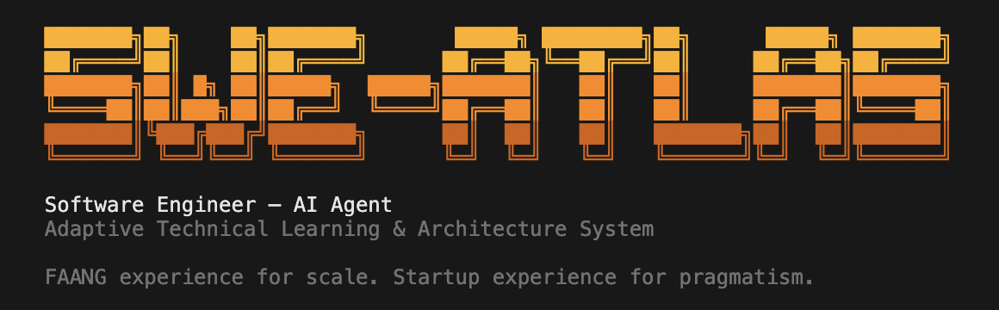
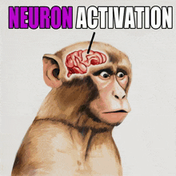

# SWE-ATLAS: an AI software engineer agent for Claude Code

[](https://www.npmjs.com/package/swe-atlas)
[](https://www.npmjs.com/package/swe-atlas)
[](https://www.npmjs.com/package/swe-atlas)



> Turn Claude Code into a senior software engineer that carries your projects end to end: from intent, to prototype, to build, to test, to deploy, and remembers each project across sessions without rescanning the repo.

```bash
npx swe-atlas@latest new-project                 # in your current repo
npx swe-atlas@latest new-project my-workspace    # or a new workspace for many projects
```

One command. Works on macOS, Linux, and Windows.

SWE-ATLAS is an open-source **Claude Code template** and **AI coding agent** setup: skills, subagents, slash commands, hooks, and engineering conventions that make Claude Code behave like a senior engineer who has shipped before. It explores before it builds (wireframes, clickable prototypes, visual plans), keeps a short memory per project, handles API keys without ever showing them in chat, talks to Postgres through `psql`, and writes the deploy runbook. Then it hands execution to Claude Code's own plan mode, `/goal`, and workflows.

It ships in **three CLAUDE.md flavors**, so you choose how much of the wheel to hand over:

- **Vanilla**: minimal footprint, no ATLAS identity.
- **Collaborative** *(default)*: the full senior-engineer identity with a review-and-commit loop; you stay in the driver's seat.
- **Autonomous**: the approval loop removed and **`free-will`** wired in, the skill that lets ATLAS **decide for itself** on the high-stakes forks: hold real alternatives open, ground each in evidence, refute the winner, then log the call in `docs/decision_logs/`. That's what lets it **one-shot an app** and run unattended without going off the rails.

And it runs in **three workspace modes**: inside one repo, around one project with several repos, or as one workspace holding **many projects**. You can switch later with `/atlas:mode`.

It is not tied to a stack. Each project's map says what **kind** of software it is (web app, backend service, mobile app, desktop app, CLI, library, game, data or ML pipeline, infrastructure), and what "run it", "see it working", "test it by hand" and "release it" mean follows from that line.

---

## Claude Code already has the engine. ATLAS helps you decide what to build.

Claude Code plans before it edits, works toward a goal across turns, runs autonomously with safety checks, reviews and simplifies code, and orchestrates fleets of subagents, natively:

| Native capability | What it does |
|---|---|
| **Plan mode** and the **Explore** / **Plan** subagents | Reads the codebase and proposes a plan; touches no files until you approve |
| **[`/goal`](https://code.claude.com/docs/en/goal)** | Keeps working across turns until a checked completion condition holds |
| **[Auto mode](https://code.claude.com/docs/en/auto-mode-config)** | Approves its own safe tool calls, blocks destructive ones |
| **`/code-review`** and **`/simplify`** | Reviews a diff for bugs; cleans up the code you just changed |
| **[Dynamic workflows](https://code.claude.com/docs/en/workflows)** | Writes a script that fans out dozens of subagents and cross-checks their findings |

> **Kick off a workflow**: describe the task and ask for a workflow in your own words, or include the keyword **`ultracode`**, and Claude writes one for it. Want it always on? Set **`/effort ultracode`** and Claude plans a workflow for *every* substantive task in the session. ([How workflows work →](https://code.claude.com/docs/en/workflows))

That is the execution loop, and it keeps getting better, so ATLAS doesn't rebuild it. This release removed the ATLAS agents that the box now covers (explorer, architect, reviewer, simplifier).

What Claude Code still won't do for you: decide *what's worth building*, prove the shape works before you spend tokens generating it, remember ten projects across sessions, keep your keys out of the transcript, tell a test that can fail from one that only pads a suite, carry a project all the way to production, and keep what all of that costs in proportion to the work. That part is ATLAS.

<sub>Auto mode and dynamic workflows are in research preview at the time of writing; plan mode and `/goal` are generally available.</sub>

---

## Why not another spec framework

The popular answer to "make the AI build the right thing" has been to bolt a process framework onto the model: **Spec-Driven Development (SDD)** and the agent frameworks in the same vein (spec-kit, BMAD, Get Shit Done, and the rest). Write exhaustive specifications first, then generate the code from them. A constitution, a spec, a plan, a task breakdown: five to seven Markdown files and a multi-phase pipeline, most of it produced *before a single screen has been seen*.

Four things go wrong:

- **You plan before you've learned.** Most of the requirements and task breakdown are guesses made before anyone has seen the thing work. You pay full freight to formalize guesses, build to them task by task, and find out at the end it isn't what anyone pictured.
- **Text leaves room to disagree.** You and the model can read the same paragraph and picture two different screens, and the gap only surfaces once the code exists. Prose is the wrong medium for *"do we mean the same thing?"*
- **Markdown drifts.** Keeping `spec.md`, `plan.md`, and `tasks.md` consistent with each other and with the code is its own tax, and plain `.md` can't render the wireframe, flow, or matrix it's straining to describe.
- **The loop is already native.** Spec → plan → tasks → implement is what plan mode, `/goal`, and workflows now do on their own. Wrapping a framework around the model to make it loop reinvents what ships in the box, at a heavy token premium.

ATLAS takes the opposite bet: do the *minimum* upfront thinking that actually de-risks the build, make it cheap, fast, and visual, so a human and the model can look at the same thing and agree before a line is written, then hand a clean artifact to the native loop.

---

## What ATLAS does instead

### 1. Explore before you commit

Cheap, throwaway-friendly artifacts that let you *see* the thing before generating code for it:

- **`/brainstorm:wireframe`**: a low-fi wireframe as one self-contained HTML file
- **`/brainstorm:prototype`**: a clickable, multi-screen React prototype
- **`/design:create-design-md`**: three real design variants you compare in a browser, then lock as the project's `DESIGN.md` rule
- **`/plan:visual`**: any non-UI change (refactor, migration, architecture call) as a visual HTML plan with diagrams, a change map, and decision matrices

### 2. Clarify only the essentials

**`/plan:create-phase`** runs the product interview from **`super-product-owner`**: one question at a time, only what's still open, stopping as soon as a one-page brief can be written. The output is a wireframe-first `phase.html` with **acceptance checks** instead of user stories. No constitution, no task ledger.

### 3. Remember every project, cheaply

Each project gets a small memory that a fresh session reads in a few thousand tokens instead of scanning the repo:

| File | Layer | What it holds |
|---|---|---|
| `CLAUDE.md` (multi mode) or `PROJECT.md` | the map, 60–100 lines | what it is, its **stage** (toy / mvp / production), its **kind** (web app, CLI, library, mobile app, ...), stack, how to run, test and verify it, which document to read for which job |
| `STATUS.md` | the state, under 30 lines | now, next, blocked, last session |
| `DEPLOY.md`, `docs/decision_logs/`, `docs/phases/`, specs | deep, read on demand | the runbook, the why behind decisions, the phase docs |
| `docs/knowledge/` | knowledge notes, read on demand | the small facts a project taught that its code does not show: a gotcha, an environment quirk, behaviour that surprised someone. One fact per file |

Memory grows with the project: a new project starts with the map, the status, and an `.env.example`, and folders appear when the first decision or phase does. The stage line sets the engineering bar, so a weekend toy doesn't get production ceremony and production work doesn't get toy shortcuts. `/atlas:project open` loads a project at the start of a session; `/atlas:project wrap` updates its state at the end.

**Knowledge notes** are the part that keeps a project's hard-won details from being found twice. A session writes one the moment it learns something (`knowledge.cjs add` refuses a near-duplicate and names the note to update instead), and nothing loads them: a session lists them when it enters an unfamiliar area, one line each with a "read when", and opens only the ones that match. There is no index file. The list is computed from the notes every time, so it cannot go stale and two sessions cannot collide on it, which matters when one session hops between projects, a team of agents works on one, or several sessions run in parallel. A fact true for several projects lives once in the root `docs/knowledge/`, not in each of them. `/atlas:dream` hands the upkeep to a Sonnet subagent: merge duplicates, re-check each note against the code, delete what is no longer true, keep notes short. Its result is a diff you review.

### 4. Bring senior judgment to every turn

A persistent engineering identity (principles, roles, conventions) plus skills that load when the work calls for them. At the center is **`free-will`**: at a fork that is costly to get wrong it refuses the first plausible answer and chooses on purpose. It is sized to the fork: a decision that is cheap to undo (a new dependency, a fix that failed twice) gets a quick pass in its own reasoning, and one that is not (a stack, a schema, deprecating something others depend on) gets real alternatives, each grounded in evidence, the blast radius worked out, an attempt to *refute* the winner, and a logged decision. It fires **autonomously** on countable triggers. **`adversarial-review`** then attacks what was built: clean-context reviewers with opposing mandates, and every finding reproduced against the running app before anyone believes it.

### 5. Test what can fail

Left alone, a coding agent writes tests the way it writes code: many, and fast. Two traps follow. A unit suite written after the code restates the code (getters, framework behaviour, mocks that assert on mocks), so it is green the day it is written and goes red later only because a refactor moved a line. A scripted end-to-end suite tied to selectors and timing breaks when a button is renamed, and a session goes into repairing tests instead of the product. Both cost tokens to write and again on every later change, and neither says much about whether the feature works.

ATLAS counts a test by one thing: it fails when the behaviour it guards breaks.

- **From the acceptance checks, not from the code.** The checks agreed in the phase doc before coding become the test cases (**`/qa:create-test-cases`**), critical path first. Getters, framework behaviour and mocks of mocks get none.
- **Seen red.** For a fix or a rule that matters, ATLAS breaks it on purpose and confirms a test fails. A test that cannot fail is deleted, not kept for the count.
- **Through the real thing.** **`/qa:manual-test-run`** hands the written cases to a Haiku runner that executes them against the running app (a real browser for a web UI, HTTP calls or the shell otherwise) and reports PASS, FAIL or UNSURE with evidence per step. The cases are plain steps with an expected result each, kept in `docs/living-test-cases/`, so there is no selector script to maintain and the model doing the clicking is the cheapest one.
- **The stage sets how many.** A toy gets the one path that must work. An mvp gets the critical paths and whatever is hard to undo. Production adds failure modes and a regression test for each bug fixed.

This is not a rule against automated tests: logic with real branches gets one, and so does a bug that must not come back. Coverage is not the target, and a suite is not grown for its count.

### 6. Carry it to production

`/deploy:plan` writes the project's `DEPLOY.md` runbook, `/deploy:check` gates the release (tests, missing secrets, migration safety, build), and `/deploy:run` ships it: through your **existing CI/CD pipeline** (PR, green checks, merge with your yes), through the provider's CLI, or as exact steps you run. Then it health-checks, smoke-tests the live URL, and logs the deploy. Provider notes ship for Coolify, Vercel, Netlify, Fly.io, Railway, and Docker Compose over SSH. Production always asks first.

Not everything is a hosted deploy. For a package published to a registry, a store submission, signed binaries, or an infrastructure apply, the same runbook, gate, and check apply with different meanings: the health check becomes "install the published version and run it", and the rollback line says what recovery really is, because a published version number or an approved store build cannot be taken back. Those always ask first, in every mode.

### 7. Stay efficient while doing it

Tokens, time and context are a budget, and ATLAS treats spending them as an engineering decision like any other. The saving comes from dropping ceremony, never from dropping verification:

- **The cheapest model that can do the job.** Haiku runs written test cases and commits, Sonnet takes a scoped task against a clear spec, and the strongest model keeps the work that needs the whole conversation ([which model for which job](#which-model-for-which-job)).
- **Deliberation sized to the decision.** `free-will` spends a few lines of reasoning on a choice that is cheap to undo and keeps its full pass for the ones that are not. Skills hold their reference material back until a task needs it.
- **Rigor sized to the stage.** A toy, an mvp and a production system get different amounts of error handling, tests and review, read from the project's stage line.
- **Reviews with a number.** The count of review rounds is set before the first one: fix what blocks, report the rest, stop.
- **Context that lasts.** A project is loaded from its small memory, not from a scan of the repo; a compaction is told what to keep; long command output goes to a file and only the lines that answer the question are read back ([context](#context-compaction-and-advisor-per-workspace)).
- **Tests that earn their place**, as in section 5: no suite written to be counted.

---

## Workspace modes

| Mode | Shape | Good for |
|---|---|---|
| `repo` | ATLAS files inside one code repo, at its root | one app, one repo |
| `project` | ATLAS root wraps one project; code repos live in `repos/<name>/`, each its own git | one product with several services |
| `multi` | many projects in `projects/<name>/`, plus `index.md` (the registry, always loaded) and `general/` for work that belongs to no project | one person or team running many apps from one place |

```
my-workspace/                 (multi mode)
├── CLAUDE.md                 identity + "read index.md, then the project's map"
├── index.md                  | Project | One line | Stage | Stack | Path | Deploy | Status |
├── general/                  scratch, experiments, one-offs
└── projects/
    ├── shop/
    │   ├── CLAUDE.md  STATUS.md  DEPLOY.md  .env.example
    │   ├── docs/  misc/
    │   └── repos/web/  repos/api/      (their own git, ignored by the workspace)
    └── notes/ ...
```

Several Claude Code sessions can work on different projects in one workspace at the same time. There is no global "active project": each session carries its own. Browser sessions are named per project, Playwright MCP runs isolated, databases are registered per project, and every artifact (test runs, screenshots, prototypes) lands under its own project. Two sessions on the same project use git worktrees.

**Switching modes.** `/atlas:mode multi` (or `project`, `repo`) reads the workspace, prints the full migration plan (every move, every file created), and changes nothing until you say yes. Tracked files move with `git mv` so history follows. It warns before moving folders that hold their own git repo (virtualenvs, dev servers, and Claude Code's per-folder session history don't survive a move) and prefers adopting a repo where it sits.

---

## Updating a workspace

A workspace holds two kinds of files: the ones ATLAS shipped, and yours. When a new swe-atlas is out, `update` compares your workspace with it and tells you, file by file and folder by folder, what it recommends:

```bash
npx swe-atlas@latest update            # the recommendation; changes nothing
npx swe-atlas@latest update --apply    # apply the safe part of it
```

Inside Claude Code, `/atlas:update` runs the same comparison, shows the diffs for the files that need a decision, and stops there: it is a recommendation, and it applies only the parts you then name. Run it in a fresh session (`/clear` or `/compact` first), because a compaction in the middle of an update can lose what you approved.

| It says | Meaning | `--apply` |
|---|---|---|
| Safe to replace / New in this version | the template changed or added the file and you never edited it | writes it |
| Lines to add | `.gitignore`, `.gitattributes`, `.claude/settings.json` are missing ATLAS lines; yours stay, and no hook or rule of yours is ever removed | appends them |
| Safe to remove | the template dropped the file, and it still matches what ATLAS installed | removes it |
| Dropped by the template, left for you | a path an older ATLAS shipped, but the file was edited or nothing records that ATLAS put it there | leaves it; `--keep <path>` makes it yours |
| Has a shipped skill's name, origin unknown | a folder in `.claude/skills/` named like a shipped skill, with no record of who put it there and no file that matches a shipped one | leaves it; `--base` proves it, `--take` replaces it, `--keep` makes it yours |
| Needs a merge | you edited the file and the template changed it too | leaves it; `--stage <dir>` writes both versions and a three-way merge |
| Your edits, kept | you edited the file and the template did not change it | leaves it |
| Never touched | everything that is yours | never writes it |
| Structure this version expects | a file or folder the new version looks for somewhere else | reports it; the move is `/atlas:mode` or `/atlas:get-to-know`, with your yes |

**What is yours** is written down, not remembered: `.claude/atlas-manifest.json` lists the template's paths (`.claude/agents`, `commands`, `hooks`, `scripts`, `skills`, `templates`, `reference`, the workspace rule), the seeded files you are expected to edit (`CLAUDE.md`, `misc/self/`), and yours: `NOTES.md`, `index.md`, every project under `projects/`, `general/`, `repos/`, all of `docs/` and `misc/` that you fill, `.atlas/config.json`, `.atlas/secrets/`, env files, `settings.local.json`, your design rules. Anything the manifest does not list is yours by default, including skills, commands, and rules you added yourself. The updater refuses to write a path in that class, and a test in this repo holds it to that.

**How it tells your edits from template changes.** The scaffolder records a hash of every file it wrote in `.atlas/installed.json`. A file that still matches its recorded hash is untouched, so replacing it loses nothing. A workspace scaffolded before that record existed (3.0.0 and earlier) has no baseline: pass the version you installed as `--base` and the comparison is exact again, and `--apply` writes the record so you only do this once:

```bash
npm pack swe-atlas@3.0.0 && tar -xzf swe-atlas-3.0.0.tgz     # unpacks to ./package
npx swe-atlas@latest update --base ./package
```

`--take <path>` overwrites one file or folder with the template's version (it also installs a skill you skipped: `--take .claude/skills/shadcn`), and `--keep <path>` keeps yours and stops reporting it. `--keep` also works on a file the update would remove or add lines to (`.claude/settings.json`, `.gitignore`): the path is yours from then on, recorded under `kept` in `.atlas/installed.json`. `--keep` settles files that are in your workspace: under `--keep <folder>`, a file that is already up to date is not counted, and a file new in this version is still offered afterwards. A `--keep` or `--take` that matches nothing in the report is an error and nothing is written, so a typo cannot pass for a decision.

What it refuses outright: a folder that is not an ATLAS workspace (a `CLAUDE.md` and a `.claude/` folder are not enough), a path that is or sits under a symlink (the file behind it may be outside the workspace), a path where a file sits where the template needs a folder or the other way round, `--take` on a folder of your own that shares a shipped skill's name, and a `--stage` folder whose `new/`, `base/` or `merged/` would be the workspace itself or a folder above it. Every path is checked before the first write, so a refusal leaves nothing half done.

---

## Getting started

### Quick start

```bash
# Inside an existing repo: repo mode is detected
cd your-project
npx swe-atlas@latest new-project

# A new workspace for many projects: multi mode is the default
npx swe-atlas@latest new-project my-workspace
```

The CLI asks for the **CLAUDE.md flavor**, your name, the **workspace mode** (and the project's name and stage), **browser automation** (Playwright MCP or Playwright CLI), **which skills to install** (an interactive checkbox: ↑/↓ move, space toggles, `a` selects all), when to **auto-compact**, and an optional **advisor model**. Then it copies everything from this repo as the single source of truth. Piped input works too: the skills picker falls back to comma-separated numbers (`*` = all) when stdin isn't a terminal.

**In a folder that already has files.** `new-project` checks the whole target before it writes anything: a symlink on the way to a file it would write, a file where it needs a folder, a `settings.json` that is not a JSON object, or an `.atlas/config.json` that does not parse stops the run with nothing written. A file already sitting at a path the template ships is replaced silently only when the install record shows it is still exactly what ATLAS put there. Any other file that differs (your own `.claude/commands/git/commit.md`, a command you edited) is listed, every one by its path, and you are asked once whether to replace the lot; No keeps yours and writes everything else. A skill is written whole or not at all, so a folder of your own under a shipped skill's name gets no ATLAS files beside yours. Your `.mcp.json` servers, your settings and hooks, and your `.gitignore` and `.gitattributes` lines are merged, not replaced, and JSON files keep their indentation. Files from a 2.x scaffold are cleaned up only when they still match what that release shipped, so an agent, a hook or a `DESIGN.md` you wrote or filled in at one of those paths stays. The 2.x notification hooks leave your settings once their scripts are gone, including the `.js` names 2.1 to 2.6.2 used, and the run says how many it removed. A 2.x hook line you extended with a command of your own (the old notification script, then `; my-logger`) is left as it is and shown, for you to take the removed script out of. Run again over an ATLAS workspace, it defaults to the mode and project name the workspace has and leaves other keys in `.atlas/config.json` alone. In a repo that had uncommitted work, or a folder that held files and had no git yet, the final commit prompt defaults to No, because that commit would include them. If a run stops partway (a file it cannot write), it says so; running the same command again finishes it, the 2.x cleanup included.

To move an existing workspace to a newer version, use `update`, not `new-project`. A workspace from 3.0.0 or earlier has no install record, so `new-project` cannot tell its own older files from yours and can only ask about all of them together; `update` sorts them one by one.

### Pick your CLAUDE.md flavor

| Flavor | What you get |
|---|---|
| **Vanilla** | Minimal CLAUDE.md: NOTES.md and decision logs, no ATLAS identity |
| **ATLAS — autonomous** | Full identity, no approval loop, built for unattended runs and one-shotting apps. Auto-installs `free-will`, `super-product-owner`, and `super-ui-ux-design`, the skills that stand in for the missing approval loop |
| **ATLAS — collaborative** *(default)* | Full identity with the partner review/commit loop. You stay in the driver's seat |

### A typical first loop

```
/atlas:project add shop             # multi mode: register a project (repo/project mode: /atlas:get-to-know)
/brainstorm:prototype               # validate the idea as a clickable prototype
/design:create-design-md            # lock the visual identity for this project
/plan:create-phase "checkout"       # interview → brief → phase.html with acceptance checks
# → switch to plan mode and let Claude Code build from it
/qa:manual-test-run shop checkout   # run the checks in a real browser
/deploy:plan shop                   # write the runbook, then /deploy:check and /deploy:run
```

### Going autonomous

- **Scaffold the autonomous flavor**: full ATLAS identity with no approval gate.
- **`/atlas:oneshotapp "idea"`**: idea to working app in one shot: a brief with acceptance checks, `free-will` on the founding fork and every mid-build trigger, a walking-skeleton build loop, adversarial-review subagents, and a final conscious pass against the original ask, with the full decision trail in `docs/decision_logs/`.
- **Pair it with Claude Code's native loop**: drop the phase doc into plan mode, then let `/goal` and auto mode run it to completion.
- **Add an advisor**: pick `opus` or `fable` as the advisor model at scaffold time (or later with `/atlas:settings`) for a second opinion on the same forks where `free-will` fires.

### Manual setup

```bash
git clone --recurse-submodules https://github.com/syahiidkamil/Software-Engineer-AI-Agent-Atlas
cd Software-Engineer-AI-Agent-Atlas
```

Then run `/atlas:get-to-know` inside Claude Code.

---

## What's in the box

ATLAS works in seven roles: Software Engineer, Solution Architect, Software Architect, Tech Lead, Business Analyst, Product Owner, and UI/UX Designer.

### 14 Skills

Installed à la carte. The scaffolder pre-checks `super-product-owner`, `super-ui-ux-design`, `frontend-design`, `human-writing`, `adversarial-review`, and `deploy`; the autonomous flavor adds `free-will`, and choosing Playwright CLI adds `playwright-cli`. Heavy document skills (`docx`, `pptx`, `xlsx`, `pdf`) stay out of the package to keep it small; scaffolded workspaces get the canonical versions through the [anthropics/skills](https://github.com/anthropics/skills) submodule at `docs/external-information/skills`.

| Skill | Command | What it does |
|-------|---------|--------------|
| Free Will | `/free-will` | Deliberate choice at a fork that is costly to get wrong, sized to the fork: a quick pass in its own reasoning when the decision is cheap to undo; options, evidence, consequences, an attempt to refute the winner and a logged decision when it is not. Fires autonomously on countable triggers |
| Super Product Owner | `/super-product-owner` | Decide what is worth building: one-question-at-a-time interview, a one-page brief, a prototype hand-off, a taste review, and acceptance checks instead of user stories |
| Super UI/UX Design | `/super-ui-ux-design` | Design theory (UX laws, heuristics, hierarchy, WCAG) fused with an execution playbook for distinctive, production-grade interfaces |
| Adversarial Review | `/adversarial-review` | Presume what was just built is broken: clean-context reviewers with opposing lenses, every finding reproduced against the running app |
| Deploy | `/deploy` | Provider-agnostic deploys: the DEPLOY.md runbook, a release gate, CI/CD-aware shipping, health checks, smoke tests, rollback. Provider notes for Coolify, Vercel, Netlify, Fly.io, Railway, Docker Compose over SSH |
| Frontend Design | `/frontend-design` | Distinctive, intentional visual design that doesn't read as a template ([anthropics/skills](https://github.com/anthropics/skills)) |
| shadcn | `/shadcn` | shadcn/ui components, presets, registries, design systems, and project init ([shadcn-ui/ui](https://github.com/shadcn-ui/ui)) |
| Supabase Postgres Best Practices | `/supabase-postgres-best-practices` | Postgres anywhere: schema, migrations, RLS, indexes, functions, slow queries, locking ([supabase/agent-skills](https://github.com/supabase/agent-skills)) |
| Playwright CLI | `/playwright-cli` | Token-efficient browser automation through the Playwright CLI instead of MCP tool schemas ([microsoft/playwright-cli](https://github.com/microsoft/playwright-cli)) |
| Human Writing | `/human-writing` | Prose indistinguishable from a skilled human in any language (English and Bahasa Indonesia built in; add more via `languages/{iso}.md`) |
| Learning From Mistakes | `/learning-from-mistakes` | Record a hard-won lesson after a bug is cracked, so it's never relearned |
| Abstraction Power | `/abstraction-power` | Pattern recognition: spot repetition, extract reusable abstractions |
| Find Skills | `/find-skills` | Discover and install agent skills ([vercel-labs/skills](https://github.com/vercel-labs/skills)) |
| Skill Creator | `/skill-creator` | Create, improve, and evaluate skills ([anthropics/skills](https://github.com/anthropics/skills)) |

Vendored skills are pinned in `skills.lock.json`; `node scripts/skills-lock.cjs check` reports which ones are behind upstream.

### 4 Agents

| Agent | Model | What it does |
|-------|-------|--------------|
| manual-qa-haiku | Haiku | Default QA runner: executes written test cases against the running app (a real browser for a web UI, HTTP calls or the shell for an API, CLI, or library), PASS / FAIL / UNSURE with evidence per step |
| manual-qa-sonnet | Sonnet | Exploratory runs, visual judgment, flaky flows, and any case the haiku runner marked UNSURE |
| commit | Haiku | Git commits following the ATLAS convention |
| knowledge-dream | Sonnet | Consolidates a project's knowledge notes: merges duplicates, re-checks notes against the code, removes what is no longer true, moves shared facts to the root |

Test cases are written in the main session on your strongest model; the cheap runner only executes them. Model aliases resolve to the latest family.

### Commands

Commands are namespaced by folder under `.claude/commands/`: `brainstorm/prototype.md` becomes `/brainstorm:prototype`.

| Command | What it does |
|---------|--------------|
| `/atlas:get-to-know` | Learn a project: explore its code, record the stage, stack, run commands, env contract, and conventions in the project map |
| `/atlas:project add\|open\|status\|wrap` | Register a project, load one at session start, refresh `index.md`, or wrap a session (update `STATUS.md`, decisions, lessons, knowledge notes) |
| `/atlas:mode <repo\|project\|multi>` | Switch workspace modes: full migration plan first, nothing changes until you say yes |
| `/atlas:dream [project\|all]` | Consolidate knowledge notes with a Sonnet subagent, one per project: merge, re-check against the code, prune, shorten. Shows a diff, commits nothing |
| `/atlas:update` | Compare the workspace with the latest swe-atlas and recommend what to update: safe to replace, needs a merge, never touched, structure moves. Applies only what you approve |
| `/atlas:settings` | View or change this workspace's auto-compaction threshold and advisor model |
| `/atlas:oneshotapp "idea"` | One-shot an app autonomously: brief and acceptance checks, `free-will` at every fork, adversarial review, a conscious final pass |
| `/atlas:change-core-self` | Interview you about the project, then derive a bespoke ATLAS operating posture for it from first principles |
| `/plan:create-phase "name"` | Product interview → wireframe-first `phase.html` with clarifications, matrices, and acceptance checks, to build from in plan mode |
| `/plan:visual "what to plan"` | Any change (refactor, migration, architecture call) as a self-contained visual `plan.html` |
| `/design:create-design-md` | Prototype three visual directions, then lock the project's design as a path-scoped rule in [Stitch format](https://github.com/google-labs-code/design.md) |
| `/brainstorm:wireframe` | A quick standalone low-fi wireframe as self-contained HTML |
| `/brainstorm:prototype` | A clickable multi-screen React prototype for idea validation |
| `/qa:create-test-cases` | Write human-readable manual test cases into the project's `docs/living-test-cases/` |
| `/qa:manual-test-run` | Run them against the running app (a real browser, HTTP calls, or the shell) with the haiku runner (or sonnet), re-run UNSURE cases on sonnet, file the report and bugs under the project |
| `/deploy:plan` | Write or update the project's `DEPLOY.md` runbook, detecting an existing CI/CD pipeline |
| `/deploy:check` | Gate a release: tests, missing secrets for the target env, migration review, build, runbook, pipeline status |
| `/deploy:run` | Deploy through the pipeline, the provider CLI, or exact steps; then health-check, smoke-test, and log it |
| `/start:be-fe` | Start a project's local processes in the background (servers, workers, emulators), with port checks first |
| `/git:commit` | Commit what's already staged (commit subagent, in the background) |
| `/git:stage-commit` | Stage and commit all working-directory changes in coherent commits |
| `/git:log` | Recent commits with a brief summary and their link to the working tree |

---

## Integrations

### Secrets: enter a key once, reuse it everywhere

Keys you reuse across projects (LLM providers, email, storage, payment test keys, deploy tokens) live in one gitignored store at the workspace root, `.atlas/secrets/`: `global.env`, `projects/<name>.env`, and `projects/<name>@<env>.env`, in that order of priority. A project declares the keys it needs, by name, in its `.env.example`.

```bash
node .claude/scripts/secrets.cjs set OPENAI_API_KEY            # in your terminal: hidden prompt
node .claude/scripts/secrets.cjs keys shop                      # names and sources, never values
node .claude/scripts/secrets.cjs link shop                      # fill .env.local next to each .env.example
node .claude/scripts/secrets.cjs check shop --env prod          # which declared keys are missing
node .claude/scripts/secrets.cjs run shop -- vercel deploy      # run a command with the keys injected
```

A value never goes on a command line or into the chat. Store it in your own terminal (hidden prompt), with `--from-file` for keys and PEMs, or from inside Claude Code after copying it: `! pbpaste | node .claude/scripts/secrets.cjs set KEY` (Linux `wl-paste`, Windows `powershell -c Get-Clipboard`). Re-running `link` after a rotation refreshes `.env.local`; it only writes gitignored names (`.env`, `.env.local`, `.env.<name>.local`).

The guardrails are layered rather than a promise: permission rules deny the Read/Edit tools on the store and on real `.env` files; a `PreToolUse` hook blocks the shell commands an agent plausibly runs on them (`cat .env*`, `cd .atlas && ...`); `run` and `db.cjs` mask stored values, including their JSON-escaped and multi-line forms, in captured output. They stop accidental leaks into the transcript. They are not a sandbox: a command written to get around them (an encoded value, a tool that loads `.env` by itself) can. Prefer `run` over `link` when a command doesn't need the file on disk, and prefer scoped, expiring tokens from your providers.

### Databases: `psql`, one registry, each connection switchable

ATLAS reaches Postgres through the `psql` CLI instead of an MCP server, so there are no tool schemas in every session and every Postgres feature (`\d`, `EXPLAIN ANALYZE`, `-f` files) works. Connections are registered by name in `.atlas/secrets/databases.json`, each with an `enabled` switch and a `readonly` flag (on by default for prod); the URL itself stays in the secret store.

```bash
node .claude/scripts/db.cjs add shop-dev --project shop --url-env SHOP_DEV_DATABASE_URL
node .claude/scripts/db.cjs list
node .claude/scripts/db.cjs shop-dev -c "select count(*) from orders"
node .claude/scripts/db.cjs shop-prod -f report.sql             # prod starts read-only: accidental writes fail
```

The URL reaches `psql` only through `PG*` environment variables, never the command line, and output captured by an agent is masked. Read-only mode starts every transaction read-only, which stops accidents but can be switched off by a session; for a hard guarantee, point prod at a role that only has `SELECT`. Install `psql`:

| OS | Command |
|---|---|
| macOS | `brew install libpq && brew link --force libpq` (or `brew install postgresql`) |
| Debian / Ubuntu | `sudo apt install postgresql-client` |
| Windows | the PostgreSQL installer with only "Command Line Tools" selected, then add its `bin` to PATH |
| Any OS with Docker | `docker run --rm -it postgres:17 psql ...` |

### Browser automation

A scaffold-time choice, with an **isolated** (in-memory, parallel-safe) or **persistent** profile in repo and project mode. Multi mode is always isolated by default; a project that needs a saved login keeps its own profile in `projects/<name>/misc/.playwright/`.

- **[Playwright MCP](https://github.com/microsoft/playwright-mcp)**: rich page snapshots through MCP tools.
- **[Playwright CLI](https://github.com/microsoft/playwright-cli)**: the token-efficient alternative, called through Bash (`playwright-cli -s=shop click e12`); install the binary with `npm install -g @playwright/cli@latest`.

### Spoken notifications

When Claude finishes or needs you, ATLAS says so out loud in a few words: the first word of the project name, the initials of the rest, then the event. `saori-hibana` becomes "saori sh done"; `bank-asset-management` asking a question becomes "bank bam ask input". In multi mode it names the project the session is working on, so parallel sessions are distinguishable by ear. It uses `say` on macOS, `spd-say` or `espeak` on Linux, and Windows speech through PowerShell, and falls back to a bell. Override the name with `ATLAS_NOTIFY_NAME`; turn it off with `ATLAS_NOTIFY=off`.

### Context: compaction and advisor, per workspace

The scaffolder asks two questions and writes the answers into the workspace's own settings (personal `settings.local.json` or shared `settings.json`, your choice), never your global settings:

- **Auto-compact earlier** (recommended 50%): sets `CLAUDE_AUTOCOMPACT_PCT_OVERRIDE`. Output quality tends to slip well before the hard limit, and project memory makes a fresh context cheap to rebuild. The variable can only lower the threshold; to change the window itself, use `/autocompact`.
- **Advisor model** (`opus`, `fable`, `sonnet`, or none): sets `advisorModel`, a second opinion Claude can call on hard decisions. The advisor must be at least as capable as your main model, and it uses extra usage.

Change either later with `/atlas:settings`.

Three more things keep a long session cheap, and they need no setting:

- **A compaction is told what to keep.** A `PreCompact` hook (`.claude/hooks/compact-keep.cjs`, in the shared `settings.json`) hands every compaction, `/compact` or automatic, a short list: what you approved and what you ruled out, your standing instructions, what is done and verified against what is left, the decisions and the files touched. In multi mode it also names the project the session is on. What you type after `/compact` is passed along and comes first.
- **Review rounds have a number.** `adversarial-review` sets the number of rounds before the first one (one for a feature, two for a release), because a fresh reviewer always finds something and "review until clean" never ends. After the last round it fixes what blocks, lists the rest as known gaps, and leaves another round to you.
- **Long output stays out of the conversation.** The workspace rule tells ATLAS to use a failures-only test reporter, a `--stat` before a full diff, a line range of a large file, and to put a long log in `gitignored/` and read from there, since everything a command prints is paid for again on every later turn.

### Agent teams (recommended)

Claude Code can run a team of sessions instead of one: a lead that hands out work, and teammates that each have their own context window, share a task list, and message each other directly. A subagent only reports back to the session that started it. The feature is experimental and off by default, so ATLAS does not switch it on for you. We recommend setting it to `1`:

```json
{
  "env": {
    "CLAUDE_CODE_EXPERIMENTAL_AGENT_TEAMS": "1"
  }
}
```

Put it in `~/.claude/settings.json` to have it in every project, or in a workspace's `.claude/settings.local.json` for that workspace only, then start a new session and ask in plain words ("spawn three teammates to review this from different angles"). Teammates load the workspace's `CLAUDE.md`, MCP servers and skills, and the agents ATLAS ships (`manual-qa-haiku`, `manual-qa-sonnet`, `commit`, `knowledge-dream`) can be used as teammate roles. Nothing in ATLAS depends on it: with the variable unset the same agents run as subagents.

What it costs: a team uses noticeably more tokens than one session, there is one team per session, and teammates are not restored by `/resume`. The full list of limits and the display modes are in the Claude Code documentation: [Orchestrate teams of Claude Code sessions](https://code.claude.com/docs/en/agent-teams).

### Which model for which job

One Claude Code session can use Fable, Opus, Sonnet and Haiku together: a main model, and a different one for each subagent. The reference is Anthropic's guide, [Which Claude model should you build with? Fable, Opus, Sonnet, or Haiku](https://claude.dev/blog/which-claude-model-should-you-build-with/). The strategies below are that guide's rules plus how ATLAS applies them. A README is for you, not for the model, so the parts ATLAS has to act on (which model a subagent gets, when to escalate, what makes a test worth keeping) are also written into `misc/self/engineering.md`, which the two ATLAS flavors load in every session.

<details>
<summary><b>Model, effort, planning and testing strategies</b></summary>

<br>

**1. Start on one model, and move only when the work says so.** Most work starts on Opus 5.5 at its default effort, `medium`.

| Work | Model | Effort |
|------|-------|--------|
| Everyday engineering, a feature across several PRs | Opus 5.5 | `medium`, then `high` |
| A bug fix, a feature built against a clear spec | Sonnet 5.5 | `medium`, then `high` |
| Search, logs, summaries, running written test cases, commits | Haiku 5.5, or Sonnet 5.5 when it needs judgment | default |
| Major refactors, migrations, architecture, leading many subagents | Fable 5.2 | `medium`, then `high` |

Prices per million tokens, input / output, in November 2026: Haiku 5.5 $0.10 / $0.50, Sonnet 5.5 $2 / $10, Opus 5.5 $4 / $20, Fable 5.2 $8 / $40.

**2. When a result is not good enough, escalate in this order.** First have the model verify its own work. Then raise effort one level. Only then move up a model, at a lower effort. Past `high`, one more effort level can cost as much as the bigger model, and more effort does not give a model knowledge it lacks.

**3. Several models in one session: a stronger lead, cheaper hands.** ATLAS's agents are set up this way: `manual-qa-haiku` and `commit` run on Haiku, `manual-qa-sonnet` and `knowledge-dream` on Sonnet, and test cases are written in the main session on your strongest model. It pays for independent work done in parallel, for reading-heavy and mechanical runs, and for a review by a model that did not write the code. Skip it for one chain of dependent steps, or for work that fits in one context window: every handoff drops context, and switching models gives up the cache. Keep a multi-model setup only if it beats the single model on your own work.

**4. Plan before code when the change is vague or hard to undo.** A result that does not match what you pictured is cheapest to catch in a wireframe, before any code exists: `/brainstorm:wireframe`, `/plan:visual`, or `/brainstorm:prototype` for something clickable. Skip planning for a small, clear change.

**5. Tests that can fail.** A green suite is not evidence on its own; tests written after the code tend to describe the code. Derive them from acceptance checks agreed before coding (`/qa:create-test-cases`). Break the fix on purpose and confirm a test goes red; delete a test that cannot. Prefer a few runs against the real app (`/qa:manual-test-run`) to many tests of helpers and mocks. Before shipping, have a reviewer that runs the thing rather than reads the diff (`/adversarial-review`).

**6. Speed comes from fewer round trips.** Fast mode on Opus 5.5 and Fable 5.2 buys output speed at about twice the price, which is worth it only while you wait at the keyboard. What stretches a task is rework and waiting on answers: a clear spec up front and independent parts run in parallel save more time than a faster model.

</details>

### macOS, Linux, Windows

Every script and hook is plain Node (≥ 18, no dependencies): paths through `path`, child processes with argument arrays (never shell strings), binaries probed before use, no symlinks. Hook commands use Claude Code's `${CLAUDE_PROJECT_DIR}` placeholder, which works under sh, Git Bash, and PowerShell. CI runs the scaffolder in all three modes on Ubuntu, macOS, and Windows.

---

## How it works

### Neuron activation through structure



AI coding assistants keep deep engineering capability locked behind generic defaults. Ask "write a function" and you get code. Give the same model structured context, engineering principles, and a persistent identity, and you get architected solutions: proper abstractions, error handling, scalability considered. ATLAS supplies those patterns every session.

### Ground truth over guesswork

ATLAS treats its own output as something to verify, not assert. It reads the file before describing the code, runs the thing before calling it done, and looks at the screen before reporting the UI. You can't specify your way out of a wrong assumption; you can only test it.

### Vibecoding with guardrails

ATLAS keeps the conversational speed but anchors it to production-grade, industry-appropriate defaults, scaled to the project's stage: KISS, YAGNI, and DRY applied in balance, not as an excuse to under-build.

---

## FAQ

**Is SWE-ATLAS a Claude Code plugin?**
It's a Claude Code template: plain files (`CLAUDE.md`, `.claude/skills`, `.claude/agents`, `.claude/commands`, hooks, rules, and a few Node scripts) scaffolded into your repo or workspace. Nothing runs outside Claude Code, and everything is readable and editable.

**Can Claude Code manage multiple projects with ATLAS?**
Yes. Multi mode keeps many projects in one workspace with a registry (`index.md`) and a short memory per project, and parallel sessions on different projects don't collide.

**How is it different from spec-kit, BMAD, or other spec-driven development frameworks?**
Those formalize a spec, plan, and task list before anything is seen. ATLAS validates the shape first with a wireframe or clickable prototype, writes one self-contained HTML phase document with acceptance checks, and leaves execution to Claude Code's native plan mode, `/goal`, and workflows.

**Will my API keys end up in the chat or in git?**
Not by accident: keys are referenced by name, values stay in a gitignored store, the Read/Edit tools are denied on it, a hook blocks the usual shell access to it, and `run` / `db.cjs` mask values in output. It is layered protection, not a sandbox. See [Secrets](#secrets-enter-a-key-once-reuse-it-everywhere).

**Does it only work for web apps?**
No. The identity, project memory, planning, secrets, and review skills are stack-neutral, and each project's map carries a `Kind:` line that tells the commands what running, verifying, and releasing mean for it: a URL in a browser, a request and its response, a command and its output, a simulator, a plan diff. The QA runners drive a browser, HTTP calls, or the shell. What stays visual on purpose: wireframes, prototypes, and the UI design skills are for graphical interfaces, and `/plan:visual` covers work with no screen. A phone simulator or a game window that no tool in the session can drive is handed back to you with the exact steps rather than reported as tested.

**How do I update a workspace when a new version is out?**
`npx swe-atlas@latest update` prints a recommendation and changes nothing; `--apply` writes only the files you never edited. Your projects, notes, decision logs, secrets, and config are never written. See [Updating a workspace](#updating-a-workspace).

**Does it work on Windows?**
Yes. All scripts and hooks are Node, tested on Windows in CI. Claude Code recommends Git for Windows for its Bash tool.

**Which models does it use?**
Your main session runs whatever model you pick (Opus or Fable for the hardest work). The QA runners use Haiku and Sonnet, the commit agent uses Haiku, and an optional advisor can be Opus, Fable, or Sonnet.

---

## Repository structure

```
├── CLAUDE.md                    # ATLAS identity & entry point (this repo's own)
├── NOTES.md                     # Notes and must-follow rules
├── claude_md_variants/          # CLAUDE.md flavors the CLI scaffolds from
├── bin/install.js               # The CLI: new-project (scaffold) and update
├── bin/lib/                     # template.js (what the template ships), update.js (plan, apply, stage)
├── .claude/
│   ├── atlas-manifest.json      # Who owns which path: template, seeded, additive, yours
│   ├── skills/                  # 14 skills, installed à la carte
│   ├── agents/                  # 4 agents (QA runners, commit, knowledge-dream)
│   ├── commands/                # Slash commands: atlas/ brainstorm/ deploy/ design/ git/ plan/ qa/ start/
│   ├── hooks/                   # notify.cjs (spoken notices), guard-secrets.cjs (secret guard), compact-keep.cjs (what a compaction keeps)
│   ├── reference/               # kinds.md: what run, verify, QA and release mean per kind of software (read on demand)
│   ├── rules/                   # workspace.md (always loaded); design/<project>.md (path-scoped)
│   ├── scripts/                 # secrets.cjs, db.cjs, project.cjs, knowledge.cjs, mode.cjs, port.cjs, lib/
│   └── templates/               # project map, STATUS, DEPLOY, .env.example, index.md, DESIGN.md
├── docs/
│   ├── decision_logs/           # ADR-style decisions: choice, rejected branches, rationale
│   └── external-information/    # Reference docs + the anthropics/skills submodule
├── misc/self/                   # ATLAS identity & principles (atlas.md, engineering.md)
├── scripts/skills-lock.cjs      # Dev: which vendored skills are behind upstream
├── skills.lock.json             # Upstream source and commit of each vendored skill
└── test/                        # node:test suite: scaffold every mode, update, scripts, hooks, README drift
```

Run the tests with `npm test`.

---

**`npx swe-atlas@latest new-project` and start building.**

*ATLAS: FAANG experience for scale. Startup experience for pragmatism.*
